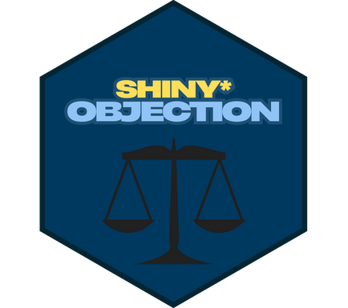

# Shiny Objection



Shiny Objection is a fictional courtroom game designed for Shiny for Python.
Play as the prosecutor or defense attorney, investigate leads, and use the
evidence you find to question witnesses and argue your side of the case.

## How a case plays

1. Receive a randomly selected case, read its opening police briefing, and
   choose a side.
2. Tell the game what you want to investigate. Review the evidence and
   potential witnesses your leads uncover, then choose two witnesses.
3. Examine your witnesses and cross-examine the other side's. Present
   exhibits, object to improper questions or evidence, and respond when
   opposing counsel objects.
4. Make a closing argument. The jury explains its verdict using the trial
   record. If there is a conviction, the court hears arguments on the sentence.

Each case has an authored set of facts, evidence, and character motivations.
Players will be able to connect a hosted model using their own API token or use
an Ollama connection for dialogue.

## Run the first case

Use Python 3.11 or later.

```bash
python -m venv .venv
source .venv/bin/activate
python -m pip install -r requirements.txt
python -m shiny run app.py
```

Follow the local URL shown by Shiny. In **The Annex Ledger**, try a lead such
as “check the key cabinet,” then ask witnesses about the records they handle
or what they saw.

### Choose a dialogue mode

- **Scripted practice** runs without a model or credentials. It matches
  questions to authored testimony and is the quickest way to play.
- **Ollama** sends questions to the Ollama server that the Shiny process can
  reach. Start Ollama and use `ollama pull smollm2:135m` for a small connection
  test, or enter the name of another installed model. The default server
  URL is `http://127.0.0.1:11434`. Set `SHINY_OBJECTION_OLLAMA_URL` on the
  Shiny server if Ollama runs elsewhere. [Ollama setup](https://github.com/ollama/ollama)
- **OpenAI** accepts an API token and a model that supports structured
  outputs. The default is `gpt-4.1-mini`. The game keeps the token for
  the session, and model calls may use your API credits.

Each model receives eligible witness statements and a short excerpt of the
current witness's exchange. The game renders the selected authored response
and applies rules and verdicts from its own state.

Run the engine tests from the repository root with
`python -m unittest discover -s tests -v`.

## Project documents

See [AGENTS.md](AGENTS.md) for the development guidelines.

- [Game design](docs/game-design.md)
- [Case authoring](docs/case-authoring.md)
- [Technical architecture](docs/architecture.md)

## Contributing

Open an issue for a gameplay idea or start a branch and submit a pull request.
