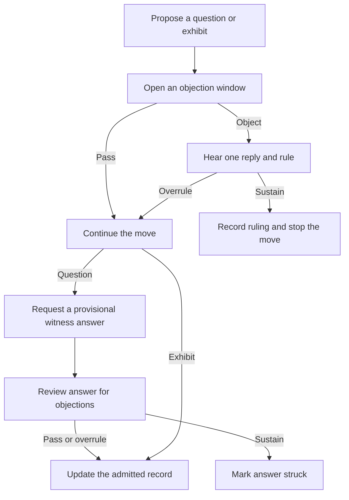

# Technical architecture

Build one playable case from both sides in Shiny for Python. A Python game
engine owns each playthrough. Shiny handles the screens and inputs, model
adapters interpret free text, and authored case files supply facts and
witness statements.

## Planned repository layout

| Path | Responsibility |
| --- | --- |
| `app.py` | Shiny interface and server session. Translate inputs to actions and render the player view. |
| `shiny_objection/cases.py` | Typed case definitions, JSON loading, reference validation, and case selection. |
| `shiny_objection/game.py` | Session state, phase transitions, investigations, witness selection, and the player view. |
| `shiny_objection/trial.py` | Examination turns, objection rules, admitted record, verdicts, and mitigation. |
| `shiny_objection/models.py` | Shared model interface and hosted and Ollama adapters. |
| `cases/` | Original, versioned case definitions. |
| `tests/` | Engine tests, fake model adapter, and first-case playthrough fixtures. |

Start with JSON files and in-memory sessions. Add storage when a feature
needs it, such as resuming a case or editing cases outside the repository.

## State and information boundaries

Load and validate each `CaseDefinition` once. Give each Shiny connection a
fresh `GameState` in its `server` function. Store the case ID and random seed,
chosen side, client conversation, investigation budget, disclosed IDs, lineups, current phase,
and pending move in that state. Keep discovery, disclosure, and admission
as separate facts about an exhibit. Draw cases from a list sorted by ID so
the same list and seed reproduce the draw. With the same seed and player
choices, the rival's scripted moves should repeat as well.

Pass the browser a projected `PlayerView` for the current phase and keep
the case files on the server. Model requests receive context appropriate
for their particular job.

| Consumer | Context |
| --- | --- |
| Player | Opening briefing, discovered and disclosed exhibits and profiles, the current move, transcript, and eligible controls. |
| Investigation matcher | The player's request and the available lead IDs and matching descriptions. The engine opens the matched reveal after validating the ID and budget. |
| Question interpreter | The pending question or exhibit offer, examination type, and relevant public record references. |
| Witness | The question after rulings, that witness's eligible statements and reactions, and the exchanges and exhibits they've already seen. |
| Jury and sentencing evaluator | The admitted record and the case's proof and mitigation mappings. |

A witness can react to free-form questions through model-selected,
case-authored statements and tone variants. For the first slice, render the
factual sentences from the case. This lets the player confront a witness
in their own words while the engine can verify every statement that enters
the record. Use authored refusals or requests for clarification when the
question cannot be answered from the witness's eligible knowledge.

## Actions and objection windows

Keep action validation and state transitions in ordinary Python. The UI
dispatches typed actions such as `Investigate`, `ChooseWitnesses`,
`AskQuestion`, `OfferExhibit`, `Object`, `ReplyToObjection`,
`Pass`, and `EndExamination`. Validate phase, acting side, active witness,
and referenced IDs before the action can change state.

The rival dispatches the same question and exhibit actions as the player.
Its authored script supplies the regular moves and eligible departures.
Pause before each challengeable move. A player chooses a ground and can
state why it applies. On a rival objection, hold the move until the player
replies or waives their reply.

The model may suggest a structured interpretation of a question or reply.
For example, it can identify a suggested answer, an exhibit ID, or a stated
purpose of notice. Use the fictional rules, the witness's case-defined
knowledge, and the existing record to decide whether the objection applies.
When an interpretation is ambiguous, ask for clarification and keep the move
pending. Rulings include a rule ID, reason, and disposition such as admitted,
admitted for a limited purpose, excluded, or struck.

Store transcript events with IDs and their status. The verdict and sentence
read a projection that includes admitted material and respects limits on
its use. For disputed exhibits, foundation comes from the relevant admitted
testimony or case-defined authentication. Compute the outcome in the engine
from the authored proof combinations, material contradictions and their
resolutions, and mitigation factors. Render the result with references to
the exhibit and testimony IDs that affected it. Match the closing arguments'
proposed links against the proof map, then evaluate the admitted record.

## Model connections

Place one structured request interface in front of both providers. The
first hosted adapter can use the OpenAI API with a player-supplied token.
The Ollama adapter can use `/api/chat` with a JSON response schema and
streaming disabled. Both return proposed structured actions or response
plans. Validate the shape and reject IDs outside the current action's
allowed set before applying any change. [OpenAI Python SDK](https://github.com/openai/openai-python) · [Ollama API reference](https://github.com/ollama/ollama/blob/main/docs/api.md)

Use a masked input for the hosted token and hold the provider client in
the server session. Clear the input after setup and discard the client on
session end. Keep the token out of prompts, replay records, and logs.

For local play, the Ollama server can be on the same machine as the Shiny
process. In a hosted deployment, the server connects to Ollama at an endpoint
configured by the operator. In that setup, the server's loopback address
refers to the host running Shiny. Show which connection and model are active
before starting a case.

Run model requests as Shiny extended tasks and pass them ordinary snapshots
of their inputs. While a request is pending, disable actions that could
submit the same move twice. Attach a request ID and turn ID to the response
so the engine can ignore a response from an earlier turn or case. A timeout
or invalid response leaves the decision pending so the player can retry.
[Shiny non-blocking operations](https://shiny.posit.co/py/docs/nonblocking.html)

## First implementation slice

1. **Case and investigation.** Write one case from the [authoring guide](case-authoring.md).
   Prove the briefing reveals only its opening material and every valid
   completed investigation path leaves two selectable witnesses.
2. **Trial and outcome.** Use a fake model through one direct and one cross
   from each side. Check that a sustained leading objection stops a direct
   question before the witness can answer, that the same ground alone can
   be overruled on cross, and that the player gets a chance to reply to a
   rival objection. Test all five grounds, including a limited-purpose
   ruling and a stricken answer that cannot affect the verdict.
3. **Shiny playthrough.** Wire the briefing, investigation, witness selection,
   courtroom, and outcome screens. Smoke-test both roles using the fake
   model. In a two-session check, verify that changing a lineup or admitting
   an exhibit in one session has no effect on the other.
4. **Real model adapters.** Exercise one playable hearing with a hosted
   model and one with Ollama. Simulate a timeout and a stale response and
   verify that neither advances the state twice.

The first case is ready for playtesting when both roles can reach a complete
trial, the player can interrupt and cross-examine the rival's witnesses, and
the game can explain an acquittal, a conviction, and a reduced sentence
from the admitted record.
