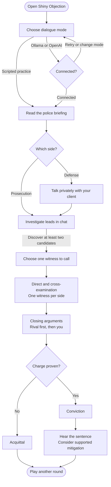

# Game workflow

A round starts with a dialogue mode and a police briefing. It ends with a
verdict based on the trial record. Scripted practice, Ollama, and OpenAI use
the same investigation and courtroom rules.

**Investigation.** Send one lead at a time, up to 240 characters. A new
match spends one slot and adds the authored exhibits and witness profiles
to your case file. Unmatched, ambiguous, and repeated leads spend no slots.
The defense consultation can suggest where to look. Its statements stay
outside the trial record.

## What happens in court

The prosecution calls its witness first, followed by the defense.
The calling side questions the witness on direct examination. The other
side then cross-examines.

| When | What you can do |
| --- | --- |
| You’re questioning | Ask a question or type an exhibit offer such as `Offer the handoff receipt` in the same chat. You can end the examination when ready. |
| The rival is questioning | The next move appears automatically. Let it proceed or object before it takes effect. A provisional witness answer can also be challenged before it enters the record. |
| The rival objects | Reply and ask the judge to rule. An overruled objection allows the move to proceed. A sustained objection can block a question, exclude an exhibit, or strike an answer. |

You can read evidence in the case file as soon as it is disclosed.
To use it as proof, get it admitted in court. See the
[courtroom action diagram](architecture.md#actions-and-objection-windows)
for the full ruling sequence.

## How the game decides the outcome

After the rival’s closing, you have up to 480 characters for your argument.
The jury checks the admitted exhibits and testimony against each element
of the charge. A conviction requires a complete proof combination for
every element, with any material contradictions in the record resolved.
Otherwise the verdict is an acquittal.

The verdict cites the record that supported the decision. Private client
statements, excluded or struck material, and testimony limited to notice
stay outside the proof of the charge. After a conviction, the court can
reduce the sentence for mitigation supported by the admitted record.

**Play another round** returns to a briefing with your chosen dialogue
mode. You can change the mode before choosing your side again.
